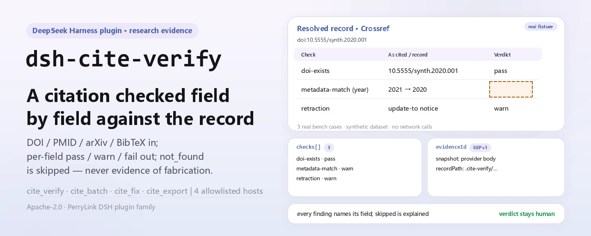
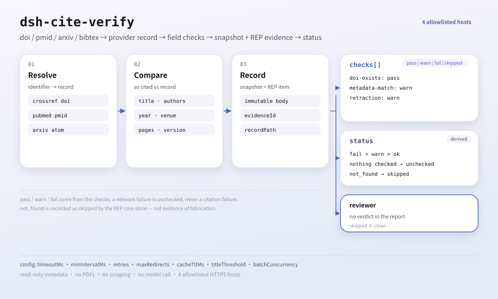
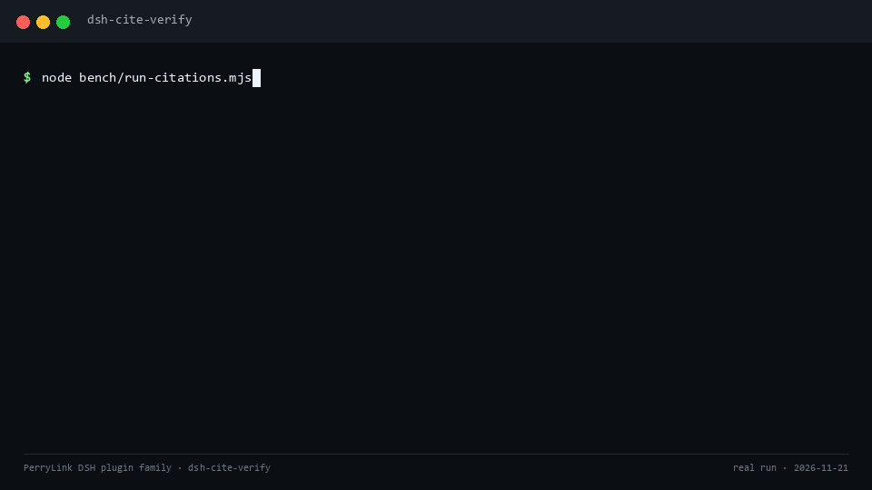

<div align="center">

<picture>
  <source media="(prefers-color-scheme: dark)" srcset="docs/assets/dsh-cite-verify-hero-en-dark.webp">
  
</picture>

# dsh-cite-verify

**Verifica que una cita existe — y que sus metadatos son correctos.**

*DOI / PMID / arXiv / BibTeX → la respuesta del propio proveedor, comprobaciones campo por campo, una instantánea direccionada por contenido y un registro de evidencia REP. `not_found` se informa como skipped, nunca como fabricación.*

[English](README.md) · [简体中文](README-zh.md) · [Español](README-es.md) · [Português](README-pt.md) · [हिन्दी](README-hi.md)

[](LICENSE)
[]()

</div>

---

## Qué hace

- Resuelve `doi` mediante **Crossref**, `pmid` mediante **PubMed E-utilities** y `arxiv` mediante la **API Atom de arXiv**.
- Compara la cita tal como está escrita con el registro resuelto: **título** (similitud de tokens), **autores** (apellidos), **año** (±1 = advertencia), **revista/evento** y **páginas**.
- Guarda la respuesta exacta del proveedor como una instantánea inmutable y registra un **elemento de evidencia REP v1** con esas comprobaciones.
- `cite_fix` devuelve una entrada BibTeX corregida **como texto** — nunca edita archivos.
- `cite_export` formatea el registro resuelto como **GB/T 7714 (numérico), APA 7, IEEE, Vancouver, BibTeX, RIS o CSL-JSON** — los campos que faltan se informan, nunca se adivinan.


<picture>
  <source media="(prefers-color-scheme: dark)" srcset="docs/assets/dsh-cite-verify-flow-v5-dark.svg">
  
</picture>

*Estructura: resolver → comparar → registrar; `checks[]` y `status` son las dos salidas, y un fallo de red es `unchecked` en lugar de un fallo de la cita. Las etiquetas de token dentro del diagrama son los nombres reales de las herramientas y de las comprobaciones, así que la misma imagen sirve para los cinco idiomas.*

## Qué no hace

- **Sin búsqueda por título.** Debes proporcionar un identificador (DOI/PMID/arXiv/BibTeX). “Encuéntrame un artículo que diga X” es otro plugin.
- **Sin monitorización de retractaciones.** v0.1 solo informa de los avisos de actualización adjuntos al propio registro resuelto (`update-to`); decidir si un trabajo está retractado requiere `dsh-retraction-watch` (W2).
- **Sin lectura de PDF.** Eso es `dsh-doc-anchor`.
- **Sin scraping.** Solo las cuatro API HTTPS de la lista de permitidos; sin CNKI, sin Sci-Hub, sin eludir paywalls.
- **Sin reparación silenciosa.** `cite_fix` informa de los diffs; aplicarlos es decisión del usuario.
- **Sin motor de estilos ni reescritura de mayúsculas/minúsculas.** Siete formatos integrados; CSL-JSON es la vía de escape para `citeproc` externo. El título se conserva tal como se proporciona.

## Compatibilidad

| | |
|---|---|
| DeepSeek Harness | **`dsh-v0.2.2-rc.4`** (verificado 2026-11-18); línea peer `>=0.2.1-0 <0.3.0 \|\| >=0.2.2-0 <0.3.0` |
| Node | `^22.19.0 \|\| >=24.9.0` (probado en `24.22.1`), solo ESM |
| Peers | `@perrylink/dsh-research-core ^0.1.0`, `@deepseek-ai/cordis ^4.0.5-alpha.1`, `@deepseek-ai/dsh-tools`, `@deepseek-ai/schemastery ^3.18.5-alpha.1` |
| Dependencias en tiempo de ejecución | **cero** |

```sh
dsh plugin --profile <name> add @perrylink/dsh-research-core dsh-cite-verify
dsh --profile <name> --dump-config | grep dsh-cite-verify
dsh plugin --profile <name> remove dsh-cite-verify
```

Cuando se monta `ctx.researchEvidence`, la evidencia va allí; en caso contrario, el plugin usa su propio almacén core bajo `root`.

## Herramientas

### `cite_verify`

| Parámetro | Tipo | Notas |
|---|---|---|
| `doi` / `pmid` / `arxiv` | string | al menos un identificador (o `bibtex`) |
| `bibtex` | string | la entrada proporciona el identificador **y** los campos esperados |
| `title`, `authors`, `year`, `venue`, `pages` | | campos tal como se citan, comparados con el registro |
| `fresh` | boolean | omite la caché de respuestas |

Devuelve `{ ok, status, notFound, lookupError, resolved, checks[], evidenceId, recordPath?, warnings[] }`.

`notFound` es true **solo** cuando ningún proveedor devolvió un registro, al menos uno devolvió definitivamente 404 y ninguna consulta falló. `lookupError` es true cuando un fallo de red, un timeout, un 5xx o una respuesta no analizable impidieron una comprobación — esa respuesta es `unchecked` y no debe leerse como “no se encontró ningún registro”. Si un identificador falla mientras otro se resuelve, el registro se devuelve igualmente con `lookupError: true`.

`status` se deriva de las comprobaciones: cualquier `fail` → `fail`, cualquier `warn` → `warn`, cualquier `pass` → `ok`, nada comprobado → `unchecked`.

### `cite_batch`

`{ citations: string[], fresh? }` donde cada elemento es `doi:10...`, `pmid:123`, `arxiv:2401.00001`, una entrada `@article{...}` o un identificador sin prefijo detectado por su forma. Concurrencia acotada, fallos aislados por elemento, detección de duplicados.

Cada elemento lleva `status`, `lookupError?`, `duplicate?` y `evidenceId?`. Un identificador repetido se marca como `duplicate: true`; conserva `fail` si ya había fallado (un duplicado nunca rebaja el peor estado) y, en caso contrario, se eleva a `warn`. El `warnings[]` del lote cuenta los duplicados.

### `cite_fix`

Las mismas entradas que `cite_verify`. Devuelve `{ ok, bibtex, diffs[], status, evidenceId?, warnings[] }`. **Solo texto — nunca escribe en disco.**

### `cite_export`

Las mismas entradas de identificador que `cite_verify`, más `style` y los opcionales `volume`, `issue`, `publisher`, `url`, `language` (`zh` selecciona 等 en lugar de et al.) e `index` (número de referencia IEEE). Pasa un objeto `record` para formatear sin conexión.

| `style` | Formato |
|---|---|
| `gbt7714-numeric` (predeterminado) | 作者. 题名[J]. 刊名, 年, 卷(期): 页. DOI. |
| `apa` | Author, A. A., & Author, B. B. (Year). Title. *Journal, Volume*(Issue), pages. https://doi.org/… |
| `ieee` | [n] A. A. Author, "Title," *Journal*, vol. V, no. I, pp. P, Year. |
| `vancouver` | Author AB. Title. Journal. Year;Volume(Issue):Pages. |
| `bibtex` | `@article{key, …}` con una clave determinista |
| `ris` | `TY  - JOUR` … `ER  -` |
| `csl-json` | elemento CSL-JSON para procesadores externos |

Devuelve `{ ok, style, entry, missing[], evidenceId?, warnings[] }`. `missing` enumera los campos ausentes del registro; un identificador sigue pasando por la misma consulta al proveedor y por la misma ruta de evidencia REP que `cite_verify`.

### Códigos de error

`INVALID_INPUT` · `INVALID_BIBTEX` · `UNSUPPORTED_IDENTIFIER` · `STORE_ERROR` · `BATCH_TOO_LARGE`

Los fallos de red nunca se convierten en fallos de cita: aparecen como comprobaciones `skipped` (`network_error`, `rate_limited`, `unavailable` para los timeouts), establecen `lookupError: true` y dejan la evidencia `unchecked` con `notFound: false`.

## Semántica de las comprobaciones

| Comprobación | pass | fail / warn | skipped |
|---|---|---|---|
| `doi-exists` | Crossref devolvió el DOI | — | `not_found` cuando Crossref no tiene ese DOI |
| `other` (existencia de PMID/arXiv) | el proveedor devolvió el registro | — | `not_found` |
| `metadata-match` (título) | similitud ≥ `titleThreshold` | `fail` por debajo del umbral | — |
| `metadata-match` (autores) | todos los apellidos citados presentes | `warn` ≥50 %, si no `fail` | — |
| `metadata-match` (año) | exacto | `warn` ±1, `fail` en otro caso | — |
| `metadata-match` (revista/evento) | similitud ≥ 0.6 | `warn` | — |
| `metadata-match` (páginas) | igualdad normalizada | `warn` | — |
| `version-match` | dos identificadores coinciden en el título | `warn` si discrepan | — |
| `retraction` | — | `warn` cuando el registro lleva un aviso de actualización | — |

`not_found` **debe** registrarse como `skipped` (lo imponen el almacén core de REP y el esquema). No es evidencia de fabricación ni evidencia de limpieza.

## Límites de red

- **Lista de permitidos**: `api.crossref.org`, `api.openalex.org`, `eutils.ncbi.nlm.nih.gov`, `export.arxiv.org` (solo HTTPS, sin credenciales, sin puerto personalizado).
- **Redirecciones**: se siguen manualmente y cada salto se revalida; una redirección a un host no permitido es un fallo duro `blocked_host`.
- **Tiempo y tasa**: timeout por solicitud, intervalo mínimo por host, un reintento acotado ante 429/503 (`Retry-After` respetado hasta 5 s).
- **Caché**: las respuestas de los proveedores se cachean bajo `<root>/cache` durante `cacheTtlMs` (7 días por defecto); `fresh` la omite. Un fallo de escritura en la caché es un cache miss, nunca un fallo.

## Configuración

| Clave | Predeterminado | Significado |
|---|---|---|
| `enabled` | `true` | `false` no monta nada |
| `root` | `.cite-verify` | raíz del almacén y de la caché |
| `userAgent` | `dsh-cite-verify/0.1.0 (…)` | se envía a cada proveedor |
| `mailto` | — | parámetros `tool`/`email` de PubMed |
| `timeoutMs` | `15000` | plazo por solicitud |
| `minIntervalMs` | `150` | intervalo mínimo por host |
| `retries` | `1` | reintentos ante 429/503 |
| `maxRedirects` | `3` | presupuesto de redirecciones (cada salto revalidado) |
| `cacheTtlMs` | `604800000` | vida de la caché (`0` la desactiva) |
| `titleThreshold` | `0.85` | similitud de título para un pass |
| `batchConcurrency` | `3` | consultas en paralelo |
| `maxBatch` | `50` | elementos por `cite_batch` |

Los valores inválidos fallan de forma explícita al montar.

## Límites de seguridad

- No se leen documentos; solo metadatos JSON/XML de cuatro hosts permitidos.
- Los cuerpos de respuesta se convierten en instantáneas inmutables; la evidencia registra la **URL** y el proveedor, nunca credenciales.
- Las comprobaciones de redirección y de lista de permitidos evitan SSRF a través de un host permitido.
- Sin telemetría, sin tokens, sin subir datos de usuario (la consulta va a la API pública de metadatos, como debe ser).

## Limitaciones conocidas (v0.1)

- **No se consulta el estado de retractación.** Solo se muestran los avisos `update-to` del propio registro resuelto, con una advertencia. La monitorización real es `dsh-retraction-watch`.
- **Metadatos solo de Crossref para los DOI.** OpenAlex está en la lista de permitidos pero aún no se usa como segunda opinión.
- **La comparación de autores se basa en apellidos.** Las partículas de los nombres y las transliteraciones pueden diferir; una discrepancia es una advertencia, no una prueba de que la cita sea errónea.
- **El análisis de BibTeX es un subconjunto** (sin expansión de macros; las llaves anidadas se conservan literalmente).
- **La caché puede estar obsoleta** hasta `cacheTtlMs`; usa `fresh` cuando importe.

## Evaluación



*Animado: la salida real por stdout del adaptador de benchmark sobre los fixtures congelados (sin red; reejecutado el 2026-11-21). Los tres falsos positivos son abreviaturas de revistas y se reportan, no se ocultan.*


### Benchmark — `dsh-research-bench` citations v0.1.0 (100 casos)

Comando (requiere el checkout de bench junto a este repositorio, o `BENCH_DIR`):

```sh
pnpm run bench:citations
```

Resultado (reproducible, conjunto de datos congelado, cada llamada al proveedor respondida desde los fixtures del caso — sin red):

| métrica | valor |
|---|---:|
| precision de existencia | **1.00** |
| recall de existencia | **1.00** |
| precision de campos | **0.9559** |
| recall de campos | **1.00** |
| F1 de campos | **0.9774** |
| precision de avisos de actualización | **1.00** |
| recall de avisos de actualización | **1.00** |
| tasa de falsos positivos en muestras limpias | **0.10** |
| tasa de coincidencia exacta | **0.97** |

Los tres falsos positivos son todos *abreviaturas de revista* (`J. Synth. Tests` vs `Journal of Synthetic Tests`) en citas por lo demás correctas: la comparación de la revista/evento es solapamiento de tokens con un umbral de 0.6 y no expande abreviaturas de revistas. Es una limitación conocida, que se reporta en lugar de ocultarse. Las diferencias de diacríticos/transliteración (`Müller`/`Muller`, `Østergård`/`Ostergard`) y los subtítulos omitidos ya no producen falsos positivos.

Predicciones sin procesar por caso: [`bench/results-citations.json`](bench/results-citations.json).

**Advertencia de alcance**: el conjunto de datos es sintético y limpio. Una puntuación de existencia de 1.0 indica que la lógica de comprobación asignó veredictos correctos a fixtures congelados; **no** predice la precisión en el mundo real, donde dominan la deriva de los proveedores, la transliteración y los metadatos ambiguos. `dsh-research-bench` es una partición de test y no se usa para ajuste.

### Pruebas unitarias y de integración

- **56 pruebas en 6 archivos**: límites HTTP (lista de permitidos, revalidación de redirecciones, reintentos, mapeo de timeouts), BibTeX (entradas con llaves y con paréntesis), comparación (incl. diacríticos/subtítulos y apellido+iniciales de PubMed), verificación (encontrado / no encontrado / timeout / PMID / arXiv / BibTeX / aviso de actualización / verificación cruzada de dos fuentes / caché / fresh, y `notFound` frente a `lookupError`, incl. un caso mixto de 404 + timeout), runtime (validez del registro REP, persistencia, reverificación sin conflicto de evidencia, aislamiento por lote, duplicados incl. estado que preserva fail, diffs de corrección), superficie de herramientas (incl. el renderizado de no encontrado frente a búsqueda fallida) y contrato del paquete.
- Cada interacción con un proveedor en la suite de pruebas está guionizada — la CI nunca depende de la red.

## Desarrollo

```sh
pnpm install
pnpm run typecheck
pnpm test
pnpm run build
pnpm run verify:package
```

## Licencia

Apache-2.0. Ningún código de terceros en tiempo de ejecución.
