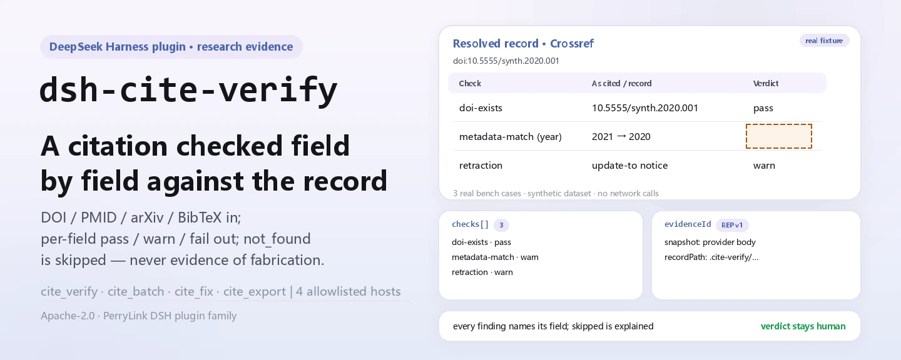
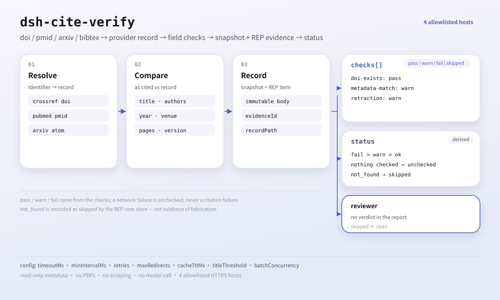
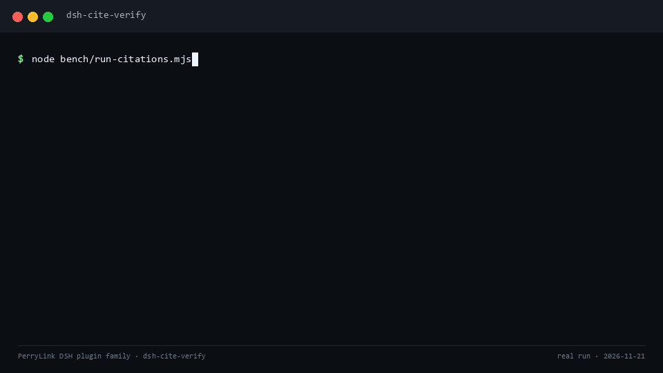

<div align="center">

<picture>
  <source media="(prefers-color-scheme: dark)" srcset="docs/assets/dsh-cite-verify-hero-en-dark.webp">
  
</picture>

# dsh-cite-verify

**सत्यापित करें कि कोई साइटेशन मौजूद है — और उसका मेटाडेटा सही भी है।**

*DOI / PMID / arXiv / BibTeX → प्रदाता का अपना उत्तर, फ़ील्ड-दर-फ़ील्ड जाँच, एक कंटेंट-एड्रेस्ड स्नैपशॉट और एक REP एविडेंस रिकॉर्ड। `not_found` को skipped के रूप में रिपोर्ट किया जाता है, कभी फ़ैब्रिकेशन के रूप में नहीं।*

[English](README.md) · [简体中文](README-zh.md) · [Español](README-es.md) · [Português](README-pt.md) · [हिन्दी](README-hi.md)

[](LICENSE)
[]()

</div>

---

## यह क्या करता है

- `doi` को **Crossref** से, `pmid` को **PubMed E-utilities** से और `arxiv` को **arXiv Atom API** से हल करता है।
- लिखी गई साइटेशन की तुलना हल किए गए रिकॉर्ड से करता है: **शीर्षक** (टोकन समानता), **लेखक** (कुलनाम), **वर्ष** (±1 = चेतावनी), **पत्रिका/सम्मेलन** और **पृष्ठ**।
- प्रदाता के सटीक रिस्पॉन्स को अपरिवर्तनीय स्नैपशॉट के रूप में संग्रहीत करता है और उन जाँचों के साथ एक **REP v1 एविडेंस आइटम** पंजीकृत करता है।
- `cite_fix` सुधरी हुई BibTeX एंट्री **टेक्स्ट के रूप में** लौटाता है — वह कभी फ़ाइलें संपादित नहीं करता।
- `cite_export` हल किए गए रिकॉर्ड को **GB/T 7714 (संख्यात्मक), APA 7, IEEE, Vancouver, BibTeX, RIS या CSL-JSON** के रूप में फ़ॉर्मैट करता है — अनुपस्थित फ़ील्ड रिपोर्ट किए जाते हैं, कभी अनुमान नहीं लगाया जाता।


<picture>
  <source media="(prefers-color-scheme: dark)" srcset="docs/assets/dsh-cite-verify-flow-v5-dark.svg">
  
</picture>

*संरचना: हल करना → तुलना करना → दर्ज करना; `checks[]` और `status` दो आउटपुट हैं, और नेटवर्क विफलता `unchecked` होती है, साइटेशन की विफलता नहीं। डायग्राम के अंदर टोकन लेबल असली टूल और जाँचों के नाम हैं, इसलिए एक ही चित्र पाँचों भाषाओं के लिए काम आता है।*

## यह क्या नहीं करता

- **शीर्षक से खोज नहीं।** आपको एक पहचानकर्ता (DOI/PMID/arXiv/BibTeX) देना होगा। “मुझे ऐसा पेपर खोजकर दो जो X कहता है” दूसरे प्लगइन का काम है।
- **रिट्रैक्शन की निगरानी नहीं।** v0.1 केवल हल किए गए रिकॉर्ड से जुड़ी अपडेट सूचनाएँ (`update-to`) रिपोर्ट करता है; किसी काम के रिट्रैक्ट होने का फ़ैसला `dsh-retraction-watch` (W2) पर है।
- **PDF पढ़ना नहीं।** वह `dsh-doc-anchor` का काम है।
- **स्क्रैपिंग नहीं।** केवल चार अनुमति-सूचीबद्ध HTTPS API; न CNKI, न Sci-Hub, न पेवॉल बायपास।
- **चुपचाप मरम्मत नहीं।** `cite_fix` डिफ़ रिपोर्ट करता है; उन्हें लागू करना उपयोगकर्ता का फ़ैसला है।
- **कोई स्टाइल इंजन नहीं और केस रीराइटिंग नहीं।** सात अंतर्निहित फ़ॉर्मैट; बाहरी `citeproc` के लिए CSL-JSON एस्केप हैच है। शीर्षक जैसा दिया गया है वैसा ही रहता है।

## संगतता

| | |
|---|---|
| DeepSeek Harness | **`dsh-v0.2.2-rc.4`** (2026-11-18 को सत्यापित); peer लाइन `>=0.2.1-0 <0.3.0 \|\| >=0.2.2-0 <0.3.0` |
| Node | `^22.19.0 \|\| >=24.9.0` (`24.22.1` पर परीक्षित), केवल ESM |
| Peers | `@perrylink/dsh-research-core ^0.1.0`, `@deepseek-ai/cordis ^4.0.5-alpha.1`, `@deepseek-ai/dsh-tools`, `@deepseek-ai/schemastery ^3.18.5-alpha.1` |
| रनटाइम निर्भरताएँ | **शून्य** |

```sh
dsh plugin --profile <name> add @perrylink/dsh-research-core dsh-cite-verify
dsh --profile <name> --dump-config | grep dsh-cite-verify
dsh plugin --profile <name> remove dsh-cite-verify
```

जब `ctx.researchEvidence` माउंट होता है तो एविडेंस वहीं जाता है; अन्यथा प्लगइन `root` के अंतर्गत अपना core स्टोर इस्तेमाल करता है।

## टूल

### `cite_verify`

| पैरामीटर | प्रकार | नोट्स |
|---|---|---|
| `doi` / `pmid` / `arxiv` | string | कम से कम एक पहचानकर्ता (या `bibtex`) |
| `bibtex` | string | एंट्री पहचानकर्ता **और** अपेक्षित फ़ील्ड दोनों देती है |
| `title`, `authors`, `year`, `venue`, `pages` | | उद्धृत किए गए फ़ील्ड, रिकॉर्ड से तुलना के लिए |
| `fresh` | boolean | रिस्पॉन्स कैश को बायपास करता है |

लौटाता है `{ ok, status, notFound, lookupError, resolved, checks[], evidenceId, recordPath?, warnings[] }`।

`notFound` केवल तब true होता है जब किसी भी प्रदाता ने रिकॉर्ड नहीं लौटाया, कम से कम एक ने निश्चित रूप से 404 लौटाया, और कोई लुकअप विफल नहीं हुआ। `lookupError` तब true होता है जब नेटवर्क विफलता, टाइमआउट, 5xx या अपार्सेबल रिस्पॉन्स ने किसी जाँच को रोक दिया — वह उत्तर `unchecked` होता है और उसे “कोई रिकॉर्ड नहीं मिला” के रूप में नहीं पढ़ा जाना चाहिए। यदि एक पहचानकर्ता विफल होता है जबकि दूसरा हल हो जाता है, तो रिकॉर्ड फिर भी `lookupError: true` के साथ लौटाया जाता है।

`status` जाँचों से व्युत्पन्न होता है: कोई भी `fail` → `fail`, कोई भी `warn` → `warn`, कोई भी `pass` → `ok`, कुछ भी जाँचा न गया → `unchecked`।

### `cite_batch`

`{ citations: string[], fresh? }` जहाँ प्रत्येक आइटम `doi:10...`, `pmid:123`, `arxiv:2401.00001`, एक `@article{...}` एंट्री, या आकार से पहचाना गया बिना उपसर्ग वाला पहचानकर्ता है। सीमित कॉन्करेंसी, प्रति-आइटम विफलताएँ, डुप्लिकेट पहचान।

प्रत्येक आइटम `status`, `lookupError?`, `duplicate?` और `evidenceId?` ले जाता है। बार-बार आने वाला पहचानकर्ता `duplicate: true` के रूप में चिह्नित होता है; यदि वह पहले ही विफल हो चुका है तो `fail` बना रहता है (डुप्लिकेट कभी भी सबसे खराब स्टेटस को नीचे नहीं गिराता) और अन्यथा `warn` तक बढ़ा दिया जाता है। बैच का `warnings[]` डुप्लिकेट की गिनती करता है।

### `cite_fix`

`cite_verify` जैसे ही इनपुट। लौटाता है `{ ok, bibtex, diffs[], status, evidenceId?, warnings[] }`। **केवल टेक्स्ट — कभी डिस्क पर नहीं लिखता।**

### `cite_export`

`cite_verify` जैसे ही पहचानकर्ता इनपुट, साथ में `style` और वैकल्पिक `volume`, `issue`, `publisher`, `url`, `language` (`zh` et al. के बजाय 等 चुनता है) और `index` (IEEE संदर्भ संख्या)। ऑफ़लाइन फ़ॉर्मैट करने के लिए `record` ऑब्जेक्ट पास करें।

| `style` | फ़ॉर्मैट |
|---|---|
| `gbt7714-numeric` (डिफ़ॉल्ट) | 作者. 题名[J]. 刊名, 年, 卷(期): 页. DOI. |
| `apa` | Author, A. A., & Author, B. B. (Year). Title. *Journal, Volume*(Issue), pages. https://doi.org/… |
| `ieee` | [n] A. A. Author, "Title," *Journal*, vol. V, no. I, pp. P, Year. |
| `vancouver` | Author AB. Title. Journal. Year;Volume(Issue):Pages. |
| `bibtex` | `@article{key, …}` डिटर्मिनिस्टिक key के साथ |
| `ris` | `TY  - JOUR` … `ER  -` |
| `csl-json` | बाहरी प्रोसेसर के लिए CSL-JSON आइटम |

लौटाता है `{ ok, style, entry, missing[], evidenceId?, warnings[] }`। `missing` रिकॉर्ड में अनुपस्थित फ़ील्ड की सूची देता है; पहचानकर्ता अब भी `cite_verify` जैसे ही प्रदाता लुकअप और REP एविडेंस पथ से गुज़रता है।

### त्रुटि कोड

`INVALID_INPUT` · `INVALID_BIBTEX` · `UNSUPPORTED_IDENTIFIER` · `STORE_ERROR` · `BATCH_TOO_LARGE`

नेटवर्क विफलताएँ कभी साइटेशन विफलता नहीं बनतीं: वे `skipped` जाँचों के रूप में दिखती हैं (`network_error`, `rate_limited`, टाइमआउट के लिए `unavailable`), `lookupError: true` सेट करती हैं, और एविडेंस को `unchecked` व `notFound: false` पर छोड़ देती हैं।

## जाँचों का अर्थ

| जाँच | pass | fail / warn | skipped |
|---|---|---|---|
| `doi-exists` | Crossref ने DOI लौटाया | — | `not_found` जब Crossref के पास वह DOI नहीं है |
| `other` (PMID/arXiv अस्तित्व) | प्रदाता ने रिकॉर्ड लौटाया | — | `not_found` |
| `metadata-match` (शीर्षक) | समानता ≥ `titleThreshold` | थ्रेशोल्ड से नीचे `fail` | — |
| `metadata-match` (लेखक) | उद्धृत सभी कुलनाम मौजूद | ≥50 % पर `warn`, अन्यथा `fail` | — |
| `metadata-match` (वर्ष) | सटीक | ±1 पर `warn`, अन्यथा `fail` | — |
| `metadata-match` (पत्रिका/सम्मेलन) | समानता ≥ 0.6 | `warn` | — |
| `metadata-match` (पृष्ठ) | सामान्यीकृत समानता | `warn` | — |
| `version-match` | दो पहचानकर्ता शीर्षक पर सहमत | असमानता पर `warn` | — |
| `retraction` | — | जब रिकॉर्ड में अपडेट सूचना हो तो `warn` | — |

`not_found` को **अनिवार्य रूप से** `skipped` के रूप में दर्ज किया जाना चाहिए (REP core स्टोर और स्कीमा इसे लागू करते हैं)। यह न फ़ैब्रिकेशन का सबूत है और न साफ़-सुथरेपन का सबूत।

## नेटवर्क सीमाएँ

- **अनुमति सूची**: `api.crossref.org`, `api.openalex.org`, `eutils.ncbi.nlm.nih.gov`, `export.arxiv.org` (केवल HTTPS, कोई क्रेडेंशियल नहीं, कोई कस्टम पोर्ट नहीं)।
- **रीडायरेक्ट**: मैन्युअल रूप से फ़ॉलो किए जाते हैं, हर हॉप फिर से सत्यापित होती है; अनुमति सूची से बाहर के होस्ट पर रीडायरेक्ट एक कठोर `blocked_host` विफलता है।
- **समय और दर**: प्रति-अनुरोध टाइमआउट, प्रति-होस्ट न्यूनतम अंतराल, 429/503 पर एक सीमित रीट्राय (`Retry-After` का 5 सेकंड तक पालन)।
- **कैश**: प्रदाता के रिस्पॉन्स `<root>/cache` के अंतर्गत `cacheTtlMs` (डिफ़ॉल्ट 7 दिन) के लिए कैश होते हैं; `fresh` इसे बायपास करता है। कैश लिखने की विफलता एक कैश मिस है, कभी विफलता नहीं।

## कॉन्फ़िगरेशन

| कुंजी | डिफ़ॉल्ट | अर्थ |
|---|---|---|
| `enabled` | `true` | `false` होने पर कुछ भी माउंट नहीं होता |
| `root` | `.cite-verify` | स्टोर + कैश रूट |
| `userAgent` | `dsh-cite-verify/0.1.0 (…)` | हर प्रदाता को भेजा जाता है |
| `mailto` | — | PubMed के `tool`/`email` पैरामीटर |
| `timeoutMs` | `15000` | प्रति-अनुरोध समय-सीमा |
| `minIntervalMs` | `150` | प्रति-होस्ट न्यूनतम अंतराल |
| `retries` | `1` | 429/503 पर रीट्राय |
| `maxRedirects` | `3` | रीडायरेक्ट बजट (हर हॉप फिर से सत्यापित) |
| `cacheTtlMs` | `604800000` | कैश जीवनकाल (`0` इसे बंद करता है) |
| `titleThreshold` | `0.85` | pass के लिए शीर्षक समानता |
| `batchConcurrency` | `3` | समानांतर लुकअप |
| `maxBatch` | `50` | प्रति `cite_batch` आइटम |

अमान्य मान माउंट के समय स्पष्ट रूप से विफल होते हैं।

## सुरक्षा सीमाएँ

- दस्तावेज़ पढ़े नहीं जाते; केवल चार अनुमति-सूचीबद्ध होस्ट से JSON/XML मेटाडेटा।
- रिस्पॉन्स बॉडी अपरिवर्तनीय स्नैपशॉट बनती हैं; एविडेंस **URL** और प्रदाता दर्ज करता है, क्रेडेंशियल कभी नहीं।
- रीडायरेक्ट और अनुमति-सूची जाँचें किसी अनुमत होस्ट के ज़रिए SSRF रोकती हैं।
- कोई टेलीमेट्री नहीं, कोई टोकन नहीं, उपयोगकर्ता डेटा का कोई अपलोड नहीं (क्वेरी सार्वजनिक मेटाडेटा API पर जाती है, जैसा होना चाहिए)।

## ज्ञात सीमाएँ (v0.1)

- **रिट्रैक्शन स्टेटस क्वेरी नहीं होता।** केवल हल किए गए रिकॉर्ड की अपनी `update-to` सूचनाएँ चेतावनी के साथ सामने आती हैं। असली निगरानी `dsh-retraction-watch` करता है।
- **DOI के लिए केवल Crossref मेटाडेटा।** OpenAlex अनुमति सूची में है, पर अभी दूसरी राय के रूप में इस्तेमाल नहीं होता।
- **लेखक तुलना कुलनाम पर आधारित है।** नाम के कण और ट्रांसलिटरेशन भिन्न हो सकते हैं; बेमेल एक चेतावनी है, गलत साइटेशन का सबूत नहीं।
- **BibTeX पार्सिंग एक सबसेट है** (कोई मैक्रो एक्सपैंशन नहीं; नेस्टेड ब्रेसिज़ ज्यों के त्यों सुरक्षित रहते हैं)।
- **कैश `cacheTtlMs` तक पुराना हो सकता है**; जब मायने रखे तो `fresh` इस्तेमाल करें।

## मूल्यांकन



*एनिमेटेड: फ़्रोज़न फ़िक्स्चर पर बेंचमार्क एडाप्टर का असली stdout (कोई नेटवर्क नहीं; 2026-11-21 को फिर से चलाया गया)। तीनों फ़ॉल्स पॉज़िटिव पत्रिका-नाम के संक्षेपण हैं और उन्हें रिपोर्ट किया जाता है, छिपाया नहीं जाता।*


### बेंचमार्क — `dsh-research-bench` citations v0.1.0 (100 केस)

कमांड (इस रेपो के बगल में bench चेकआउट, या `BENCH_DIR` आवश्यक):

```sh
pnpm run bench:citations
```

परिणाम (पुनरुत्पादनीय, फ़्रोज़न डेटासेट, हर प्रदाता कॉल केस फ़िक्स्चर से उत्तरित — कोई नेटवर्क नहीं):

| मीट्रिक | मान |
|---|---:|
| अस्तित्व precision | **1.00** |
| अस्तित्व recall | **1.00** |
| फ़ील्ड precision | **0.9559** |
| फ़ील्ड recall | **1.00** |
| फ़ील्ड F1 | **0.9774** |
| अपडेट-सूचना precision | **1.00** |
| अपडेट-सूचना recall | **1.00** |
| स्वच्छ नमूनों में फ़ॉल्स-पॉज़िटिव दर | **0.10** |
| सटीक मिलान दर | **0.97** |

तीनों फ़ॉल्स पॉज़िटिव सभी *पत्रिका-नाम के संक्षेपण* (`J. Synth. Tests` बनाम `Journal of Synthetic Tests`) हैं और बाकी सभी पहलुओं में साइटेशन सही हैं: पत्रिका/सम्मेलन तुलना 0.6 थ्रेशोल्ड के साथ टोकन ओवरलैप है और पत्रिका-नाम संक्षेपण नहीं खोलती। यह एक ज्ञात सीमा है, जिसे छिपाने के बजाय रिपोर्ट किया जाता है। डायक्रिटिक/ट्रांसलिटरेशन अंतर (`Müller`/`Muller`, `Østergård`/`Ostergard`) और छोड़े गए उपशीर्षक अब फ़ॉल्स पॉज़िटिव पैदा नहीं करते।

प्रति-केस कच्ची भविष्यवाणियाँ: [`bench/results-citations.json`](bench/results-citations.json)।

**दायरा चेतावनी**: डेटासेट सिंथेटिक और साफ़ है। 1.0 अस्तित्व स्कोर का मतलब है कि जाँच लॉजिक फ़्रोज़न फ़िक्स्चर को सही निर्णयों पर मैप करता है; यह वास्तविक दुनिया की सटीकता की **भविष्यवाणी नहीं** करता, जहाँ प्रदाता ड्रिफ़्ट, ट्रांसलिटरेशन और अस्पष्ट मेटाडेटा हावी रहते हैं। `dsh-research-bench` एक टेस्ट स्प्लिट है और ट्यूनिंग के लिए इस्तेमाल नहीं होता।

### यूनिट और इंटीग्रेशन टेस्ट

- **6 फ़ाइलों में 56 टेस्ट**: HTTP सीमाएँ (अनुमति सूची, रीडायरेक्ट पुनःसत्यापन, रीट्राय, टाइमआउट मैपिंग), BibTeX (ब्रेसिज़ और पैरेंथेसिस वाली एंट्रियाँ), तुलना (डायक्रिटिक/उपशीर्षक और PubMed कुलनाम+आद्याक्षर सहित), सत्यापन (मिला / नहीं मिला / टाइमआउट / PMID / arXiv / BibTeX / अपडेट सूचना / दो-स्रोत क्रॉस-चेक / कैश / fresh, और `notFound` बनाम `lookupError`, जिसमें मिश्रित 404 + टाइमआउट भी शामिल), रनटाइम (REP रिकॉर्ड की वैधता, पर्सिस्टेंस, एविडेंस विरोध के बिना पुनःसत्यापन, बैच लोकैलिटी, डुप्लिकेट सहित fail-संरक्षी स्टेटस, फ़िक्स डिफ़), टूल सतह (नहीं-मिला बनाम विफल-लुकअप रेंडर सहित) और पैकेज कॉन्ट्रैक्ट।
- टेस्ट सूट में हर प्रदाता इंटरैक्शन स्क्रिप्टेड है — CI कभी नेटवर्क पर निर्भर नहीं करती।

## डेवलपमेंट

```sh
pnpm install
pnpm run typecheck
pnpm test
pnpm run build
pnpm run verify:package
```

## लाइसेंस

Apache-2.0। कोई तृतीय-पक्ष रनटाइम कोड नहीं।
