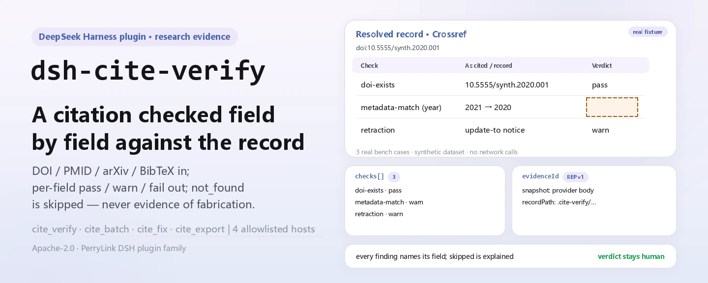
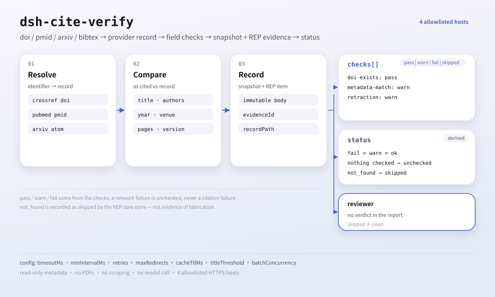
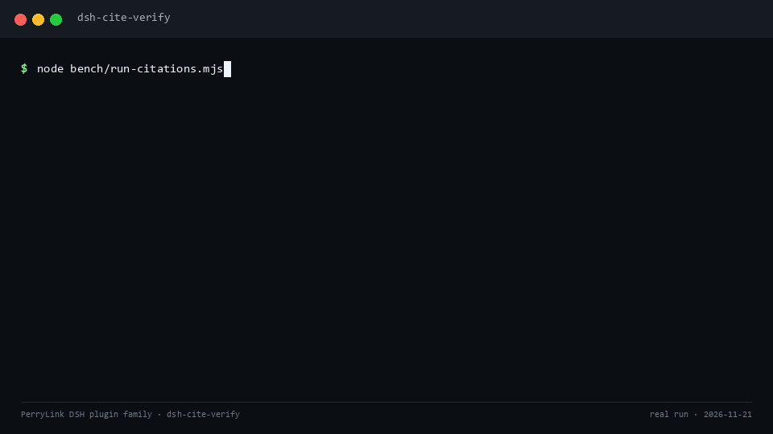

<div align="center">

<picture>
  <source media="(prefers-color-scheme: dark)" srcset="docs/assets/dsh-cite-verify-hero-en-dark.webp">
  
</picture>

# dsh-cite-verify

**Verifique se uma citação existe — e se seus metadados estão corretos.**

*DOI / PMID / arXiv / BibTeX → a resposta do próprio provedor, verificações campo a campo, um snapshot endereçado por conteúdo e um registro de evidência REP. `not_found` é reportado como skipped, nunca como fabricação.*

[English](README.md) · [简体中文](README-zh.md) · [Español](README-es.md) · [Português](README-pt.md) · [हिन्दी](README-hi.md)

[](LICENSE)
[]()

</div>

---

## O que faz

- Resolve `doi` via **Crossref**, `pmid` via **PubMed E-utilities** e `arxiv` via **API Atom do arXiv**.
- Compara a citação como escrita com o registro resolvido: **título** (similaridade de tokens), **autores** (sobrenomes), **ano** (±1 = aviso), **periódico/evento** e **páginas**.
- Armazena a resposta exata do provedor como um snapshot imutável e registra um **item de evidência REP v1** com essas verificações.
- `cite_fix` retorna uma entrada BibTeX corrigida **como texto** — nunca edita arquivos.
- `cite_export` formata o registro resolvido como **GB/T 7714 (numérico), APA 7, IEEE, Vancouver, BibTeX, RIS ou CSL-JSON** — campos ausentes são reportados, nunca adivinhados.

<picture>
  <source media="(prefers-color-scheme: dark)" srcset="docs/assets/dsh-cite-verify-flow-v5-dark.svg">
  
</picture>

*Estrutura: resolver → comparar → registrar; `checks[]` e `status` são as duas saídas, e uma falha de rede é `unchecked` em vez de uma falha da citação. Os rótulos de token dentro do diagrama são os nomes reais das ferramentas e das verificações, então a mesma imagem serve aos cinco idiomas.*

## O que não faz

- **Sem busca por título.** É preciso fornecer um identificador (DOI/PMID/arXiv/BibTeX). “Encontre para mim um artigo que diga X” é outro plugin.
- **Sem monitoramento de retratações.** A v0.1 apenas reporta avisos de atualização anexados ao próprio registro resolvido (`update-to`); decidir se um trabalho foi retratado exige `dsh-retraction-watch` (W2).
- **Sem leitura de PDF.** Isso é `dsh-doc-anchor`.
- **Sem scraping.** Apenas as quatro APIs HTTPS da lista de permissões; sem CNKI, sem Sci-Hub, sem contornar paywalls.
- **Sem reparo silencioso.** `cite_fix` reporta diffs; aplicá-los é decisão do usuário.
- **Sem mecanismo de estilos nem reescrita de maiúsculas/minúsculas.** Sete formatos embutidos; CSL-JSON é a válvula de escape para `citeproc` externo. O título é preservado como fornecido.

## Compatibilidade

| | |
|---|---|
| DeepSeek Harness | **`dsh-v0.2.3-alpha.1`** (verificado em 2026-11-22); linha peer `>=0.2.2-0 <0.3.0 \|\| >=0.2.2-0 <0.3.0` |
| Node | `^22.19.0 \|\| >=24.9.0` (testado em `24.22.1`), somente ESM |
| Peers | `@perrylink/dsh-research-core ^0.1.0`, `@deepseek-ai/cordis ^4.0.5-alpha.1`, `@deepseek-ai/dsh-tools`, `@deepseek-ai/schemastery ^3.18.5-alpha.1` |
| Dependências de runtime | **zero** |

```sh
dsh plugin --profile <name> add @perrylink/dsh-research-core dsh-cite-verify
dsh --profile <name> --dump-config | grep dsh-cite-verify
dsh plugin --profile <name> remove dsh-cite-verify
```

Quando `ctx.researchEvidence` está montado, a evidência vai para lá; caso contrário, o plugin usa seu próprio armazenamento core sob `root`.

## Ferramentas

### `cite_verify`

| Parâmetro | Tipo | Observações |
|---|---|---|
| `doi` / `pmid` / `arxiv` | string | pelo menos um identificador (ou `bibtex`) |
| `bibtex` | string | a entrada fornece o identificador **e** os campos esperados |
| `title`, `authors`, `year`, `venue`, `pages` | | campos como citados, comparados com o registro |
| `fresh` | boolean | ignora o cache de respostas |

Retorna `{ ok, status, notFound, lookupError, resolved, checks[], evidenceId, recordPath?, warnings[] }`.

`notFound` é true **apenas** quando nenhum provedor retornou um registro, pelo menos um retornou 404 de forma definitiva e nenhuma consulta falhou. `lookupError` é true quando uma falha de rede, timeout, 5xx ou resposta não analisável impediram uma verificação — essa resposta é `unchecked` e não deve ser lida como “nenhum registro encontrado”. Se um identificador falha enquanto outro é resolvido, o registro ainda é retornado com `lookupError: true`.

`status` é derivado das verificações: qualquer `fail` → `fail`, qualquer `warn` → `warn`, qualquer `pass` → `ok`, nada verificado → `unchecked`.

### `cite_batch`

`{ citations: string[], fresh? }` em que cada item é `doi:10...`, `pmid:123`, `arxiv:2401.00001`, uma entrada `@article{...}` ou um identificador puro detectado pela forma. Concorrência limitada, falhas por item, detecção de duplicatas.

Cada item carrega `status`, `lookupError?`, `duplicate?` e `evidenceId?`. Um identificador repetido é marcado como `duplicate: true`; mantém `fail` se já falhou (uma duplicata nunca rebaixa o pior status) e, caso contrário, é elevado a `warn`. O `warnings[]` do lote conta as duplicatas.

### `cite_fix`

Mesmas entradas de `cite_verify`. Retorna `{ ok, bibtex, diffs[], status, evidenceId?, warnings[] }`. **Somente texto — nunca grava em disco.**

### `cite_export`

Mesmas entradas de identificador de `cite_verify`, mais `style` e os opcionais `volume`, `issue`, `publisher`, `url`, `language` (`zh` seleciona 等 em vez de et al.) e `index` (número de referência IEEE). Passe um objeto `record` para formatar offline.

| `style` | Formato |
|---|---|
| `gbt7714-numeric` (padrão) | 作者. 题名[J]. 刊名, 年, 卷(期): 页. DOI. |
| `apa` | Author, A. A., & Author, B. B. (Year). Title. *Journal, Volume*(Issue), pages. https://doi.org/… |
| `ieee` | [n] A. A. Author, "Title," *Journal*, vol. V, no. I, pp. P, Year. |
| `vancouver` | Author AB. Title. Journal. Year;Volume(Issue):Pages. |
| `bibtex` | `@article{key, …}` com uma chave determinística |
| `ris` | `TY  - JOUR` … `ER  -` |
| `csl-json` | item CSL-JSON para processadores externos |

Retorna `{ ok, style, entry, missing[], evidenceId?, warnings[] }`. `missing` lista os campos ausentes do registro; um identificador ainda passa pela mesma consulta ao provedor e pelo mesmo caminho de evidência REP de `cite_verify`.

### Códigos de erro

`INVALID_INPUT` · `INVALID_BIBTEX` · `UNSUPPORTED_IDENTIFIER` · `STORE_ERROR` · `BATCH_TOO_LARGE`

Falhas de rede nunca se tornam falhas de citação: aparecem como verificações `skipped` (`network_error`, `rate_limited`, `unavailable` para timeouts), definem `lookupError: true` e deixam a evidência `unchecked` com `notFound: false`.

## Semântica das verificações

| Verificação | pass | fail / warn | skipped |
|---|---|---|---|
| `doi-exists` | o Crossref retornou o DOI | — | `not_found` quando o Crossref não tem esse DOI |
| `other` (existência de PMID/arXiv) | o provedor retornou o registro | — | `not_found` |
| `metadata-match` (título) | similaridade ≥ `titleThreshold` | `fail` abaixo do limiar | — |
| `metadata-match` (autores) | todos os sobrenomes citados presentes | `warn` ≥50 %, senão `fail` | — |
| `metadata-match` (ano) | exato | `warn` ±1, `fail` caso contrário | — |
| `metadata-match` (periódico/evento) | similaridade ≥ 0.6 | `warn` | — |
| `metadata-match` (páginas) | igualdade normalizada | `warn` | — |
| `version-match` | dois identificadores concordam no título | `warn` em caso de divergência | — |
| `retraction` | — | `warn` quando o registro carrega um aviso de atualização | — |

`not_found` **deve** ser registrado como `skipped` (imposto pelo armazenamento core do REP e pelo schema). Não é evidência de fabricação nem evidência de limpeza.

## Limites de rede

- **Lista de permissões**: `api.crossref.org`, `api.openalex.org`, `eutils.ncbi.nlm.nih.gov`, `export.arxiv.org` (somente HTTPS, sem credenciais, sem porta personalizada).
- **Redirecionamentos**: seguidos manualmente, cada salto revalidado; um redirecionamento para um host fora da lista de permissões é uma falha rígida `blocked_host`.
- **Tempo e taxa**: timeout por requisição, intervalo mínimo por host, uma retentativa limitada em 429/503 (`Retry-After` respeitado até 5 s).
- **Cache**: respostas dos provedores ficam em cache sob `<root>/cache` por `cacheTtlMs` (7 dias por padrão); `fresh` ignora. Uma falha de escrita no cache é um cache miss, nunca uma falha.

## Configuração

| Chave | Padrão | Significado |
|---|---|---|
| `enabled` | `true` | `false` não monta nada |
| `root` | `.cite-verify` | raiz do armazenamento e do cache |
| `userAgent` | `dsh-cite-verify/0.1.0 (…)` | enviado a cada provedor |
| `mailto` | — | parâmetros `tool`/`email` do PubMed |
| `timeoutMs` | `15000` | prazo por requisição |
| `minIntervalMs` | `150` | intervalo mínimo por host |
| `retries` | `1` | retentativas em 429/503 |
| `maxRedirects` | `3` | orçamento de redirecionamentos (cada salto revalidado) |
| `cacheTtlMs` | `604800000` | tempo de vida do cache (`0` o desativa) |
| `titleThreshold` | `0.85` | similaridade de título para um pass |
| `batchConcurrency` | `3` | consultas em paralelo |
| `maxBatch` | `50` | itens por `cite_batch` |

Valores inválidos falham de forma explícita na montagem.

## Limites de segurança

- Documentos não são lidos; apenas metadados JSON/XML de quatro hosts permitidos.
- Os corpos das respostas se tornam snapshots imutáveis; a evidência registra a **URL** e o provedor, nunca credenciais.
- As verificações de redirecionamento e de lista de permissões impedem SSRF por meio de um host permitido.
- Sem telemetria, sem tokens, sem upload de dados do usuário (a consulta vai para a API pública de metadados, como deve ser).

## Limitações conhecidas (v0.1)

- **O status de retratação não é consultado.** Apenas os avisos `update-to` do próprio registro resolvido são exibidos, com um aviso. O monitoramento real é `dsh-retraction-watch`.
- **Metadados somente do Crossref para DOIs.** O OpenAlex está na lista de permissões, mas ainda não é usado como segunda opinião.
- **A comparação de autores é baseada em sobrenomes.** Partículas de nomes e transliterações podem diferir; uma divergência é um aviso, não prova de citação errada.
- **A análise de BibTeX é um subconjunto** (sem expansão de macros; chaves aninhadas preservadas literalmente).
- **O cache pode estar desatualizado** por até `cacheTtlMs`; use `fresh` quando importar.

## Avaliação



*Animado: a saída real de stdout do adaptador de benchmark sobre os fixtures congelados (sem rede; reexecutado em 2026-11-21). Os três falsos positivos são abreviações de periódicos e são reportados, não escondidos.*

### Benchmark — `dsh-research-bench` citations v0.1.0 (100 casos)

Comando (requer o checkout do bench ao lado deste repositório, ou `BENCH_DIR`):

```sh
pnpm run bench:citations
```

Resultado (reproduzível, conjunto de dados congelado, cada chamada ao provedor respondida pelos fixtures do caso — sem rede):

| métrica | valor |
|---|---:|
| precision de existência | **1.00** |
| recall de existência | **1.00** |
| precision de campos | **0.9559** |
| recall de campos | **1.00** |
| F1 de campos | **0.9774** |
| precision de avisos de atualização | **1.00** |
| recall de avisos de atualização | **1.00** |
| taxa de falsos positivos em amostras limpas | **0.10** |
| taxa de correspondência exata | **0.97** |

Os três falsos positivos são todos *abreviações de periódico* (`J. Synth. Tests` vs `Journal of Synthetic Tests`) em citações que de resto estão corretas: a comparação de periódico/evento é sobreposição de tokens com limiar de 0.6 e não expande abreviações de periódicos. Essa é uma limitação conhecida, reportada em vez de escondida. Diferenças de diacríticos/transliteração (`Müller`/`Muller`, `Østergård`/`Ostergard`) e subtítulos omitidos não geram mais falsos positivos.

Previsões brutas por caso: [`bench/results-citations.json`](bench/results-citations.json).

**Aviso de escopo**: o conjunto de dados é sintético e limpo. Uma pontuação de existência 1.0 diz que a lógica de verificação mapeia fixtures congelados para veredictos corretos; **não** prevê a precisão no mundo real, onde dominam a deriva dos provedores, a transliteração e metadados ambíguos. O `dsh-research-bench` é um split de teste e não é usado para ajuste.

### Testes unitários e de integração

- **70 testes em 8 arquivos**: limites HTTP (lista de permissões, revalidação de redirecionamentos, retentativas, mapeamento de timeouts), BibTeX (entradas com chaves e com parênteses), comparação (incl. diacríticos/subtítulo e sobrenome+iniciais do PubMed), verificação (encontrado / não encontrado / timeout / PMID / arXiv / BibTeX / aviso de atualização / verificação cruzada de duas fontes / cache / fresh, e `notFound` vs `lookupError`, incl. um caso misto de 404 + timeout), runtime (validade do registro REP, persistência, reverificação sem conflito de evidência, localidade de lotes, duplicatas incl. status que preserva fail, diffs de correção), superfície de ferramentas (incl. a renderização de não encontrado vs consulta com falha) e contrato do pacote.
- Toda interação com provedores na suíte de testes é roteirizada — a CI nunca depende da rede.

## Desenvolvimento

```sh
pnpm install
pnpm run typecheck
pnpm test
pnpm run build
pnpm run verify:package
```

## Licença

Apache-2.0. Nenhum código de terceiros em runtime.
